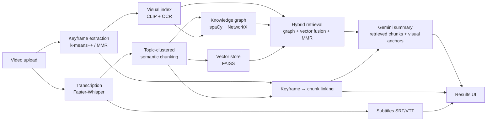

# Mimir

**Turn video into structured, searchable knowledge.**

Mimir takes an uploaded video and produces a timestamped transcript, subtitles, keyframes, a general summary and an optional topic-focused summary. Every summary is grounded in retrieved transcript chunks rather than the whole transcript. Summaries cite the keyframes that show what is being discussed, and each keyframe links back to the part of the transcript it belongs to.

## Features

| Output | How it's produced |
|---|---|
| **Transcript + subtitles** | Faster-Whisper (word-level timestamps), exported as SRT or VTT. Subtitles can be previewed with caption overlays or muxed into the video on demand. |
| **Keyframes** | 1 fps sampling, k-means++ visual clustering, scene segmentation, per-cluster caps, MMR diversity selection and perceptual-hash dedup. |
| **General summary** | Hybrid retrieval over the video's own chunks, then Gemini summarisation. Length is `short`, `medium` or `long`. |
| **Topic summary** | The same pipeline with a topic query. A relevance gate returns "no relevant content" instead of hallucinating when the topic isn't in the video. |
| **Keyframe-aware summaries** | Up to 6 keyframe-hosting chunks are fed to the LLM as *visual anchors*. Summaries say how a topic is explained and point to it with "(see Keyframe N)". The UI turns these into links to the keyframe. |
| **Keyframe ↔ transcript linking** | Each keyframe carries the time range and text of the semantic chunk it falls in. |
| **Cross-modal visual channel** | Local CLIP embeddings + OCR over keyframes. A visual knowledge graph (frame nodes, on-screen entities) is linked to spoken entities, and a CLIP text→frame channel joins hybrid retrieval. Each part is an independent flag, so it can be ablated. |
| **RAG search** | Query indexed videos through the knowledge graph and vector index (`/search` page). |
| **Pipeline logs** | Per-phase diagnostics (timings, cluster counts, retrieval scores, KG stats). Results survive navigating there and back. |
| **Auth** | JWT-based register/login. |

## Architecture



### Pipeline phases (`backend/pipeline/orchestrator.py`)

1. **Transcription + keyframes (parallel).** Whisper runs alongside keyframe extraction. Keyframes are scored on sharpness, contrast and edge density. They are clustered visually, segmented into scenes, capped per cluster and finally selected with MMR for diversity.
2. **Dual-channel indexing.** The transcript is split into sentences, clustered into topic segments and chunked on cosine drops, with TF-IDF informativeness scores. Chunks feed a **knowledge graph** (spaCy NER and subject-verb-object relations) and a **FAISS vector index**. Keyframes are then linked to the chunk whose time range contains them.
3. **Hybrid retrieval and summarisation.** Graph and vector candidates are fused and diversified with MMR, then summarised by Gemini (`gemini-2.5-flash-lite`). The prompt carries the retrieved chunks, KG relations drawn from those same chunks, and the visual anchors. If Gemini fails, an extractive fallback is used.
4. **Subtitles.** SRT or VTT from the timed transcript.
5. **Citations.** Retrieved chunks are matched to nearby keyframes.

### Cross-modal layer (`pipeline/visual_index.py`, `KnowledgeGraph.add_visual_entities`)

Runs after the text indexes are built, entirely on local models (no API quota):

- **Visual embedding.** Every keyframe is embedded with CLIP (`clip-ViT-B-32`) into a FAISS index. CLIP shares one space for text and images, so a text query can be matched straight against frames.
- **OCR.** On-screen text (slides, code, labels) is read with RapidOCR and kept per keyframe.
- **Visual knowledge graph.** Each keyframe becomes a `keyframe_N` node anchored to its chunk's time range. OCR phrases become entity nodes. When the same entity is both spoken and shown, the node becomes `modality="both"`. Visual nodes carry the chunk id, so existing graph search reaches the right chunk from on-screen text.
- **Linking to spoken entities.** CLIP scores the spoken entities of the keyframe's chunk against the frame, and the best ones get `visually grounds` edges. On-screen entities are linked to spoken ones in the same time window with `displayed-with` edges.
- **Retrieval.** The CLIP text→frame channel is a third RRF channel. It is skipped for generic "summarize" queries, where CLIP has nothing meaningful to match. A topic that is only shown, never spoken, passes the relevance gate through a CLIP threshold.
- **Summaries.** Anchors in the Gemini prompt carry the on-screen text and visible entities of each keyframe.

CLIP cosine thresholds (`visual_ground_min_sim`, the visual retrieval floor and the gate) are uncalibrated starting points, so tune them on held-out videos. The ablation harness (see Evaluation) measures whether the channel helps.

**Retrieval budget.** The number of retrieved chunks scales with video length instead of a fixed 30: general summaries use `clamp(ceil(0.15 × chunks), 15, 60)` and topic summaries `clamp(ceil(0.08 × chunks), 8, 30)`. The LLM context is fitted to a budget that grows with that count. If it is over budget, the lowest-scoring chunks are dropped (never the end of the video). Set `ADAPTIVE_RETRIEVAL_BUDGET=false` to restore fixed 30/15, for example when comparing against earlier eval runs.

**Keyframe text.** Each keyframe shows the cleaned speech within ±6 s of its timestamp (fillers and stutters removed, whole sentences), plus an optional short title from one batched Gemini call per video (`ENABLE_KEYFRAME_LABELS`), which runs in the background and falls back to the excerpt on failure.

**Diagnostics.** The Pipeline Logs page has a *Keyframe References* panel: which keyframes were offered to each summary, which the LLM cited, and any references to keyframes that were never offered.

Only the retrieved chunks, plus the keyframe-hosting anchor chunks, reach the LLM. For topic summaries the anchors are limited to chunks the topic retrieval surfaced, so keyframe references stay on-topic.

See [`docs/DESIGN_AND_ARCHITECTURE.md`](docs/DESIGN_AND_ARCHITECTURE.md) for the full design write-up.

## Tech stack

- **Frontend:** React 18, Vite, React Router 7, Tailwind CSS 4, Recharts, lucide-react
- **Backend:** FastAPI, SQLite (tasks and users), background-task processing
- **ML / NLP / CV:** faster-whisper, sentence-transformers (`all-MiniLM-L6-v2`), FAISS, spaCy, NetworkX, scikit-learn, OpenCV, imagehash
- **LLM:** Google Gemini (summaries)

## Getting started

### Prerequisites

- Python 3.12 (see `backend/.python-version`), Node.js 18+
- `ffmpeg` on your `PATH`, used for subtitled-video export
- A [Gemini API key](https://aistudio.google.com/) for summaries. Without one, summaries fall back to extractive mode.
- A GPU is optional. The pipeline runs on CPU and uses CUDA when it's available.

### Backend

```bash
cd backend
python -m venv venv && source venv/bin/activate
pip install -r requirements.txt          # macOS: requirements-macos.txt or install_macos.sh
python -m spacy download en_core_web_sm

cat > .env <<'EOF'
GEMINI_API_KEY=your-key-here
JWT_SECRET_KEY=change-me
EOF

python main.py                           # http://localhost:8000  (API docs at /docs)
```

Other install helpers (`install_simple.sh`, `install_working.sh`, `fix_dependencies.sh`) and `start_server.sh` / `start_dev.py` are in `backend/`.

### Frontend

```bash
cd frontend
npm install
npm run dev                              # http://localhost:5173
```

Set `VITE_API_URL` if the backend isn't at `http://localhost:8000`.

### Configuration

Settings are read from `backend/.env` (see `backend/pipeline/config.py`):

| Variable | Default | Purpose |
|---|---|---|
| `GEMINI_API_KEY` | — | Gemini summarisation |
| `JWT_SECRET_KEY` | dev placeholder | **Change in production** |
| `USE_GPU` | `true` | Use CUDA when available |
| `WHISPER_MODEL` | `tiny` | Whisper model size |
| `SPACY_MODEL` | `en_core_web_sm` | NER / relation extraction |
| `MAX_FILE_SIZE_MB` | `500` | Upload limit |
| `UPLOAD_DIR` | `uploads` | Per-task artefacts (video, frames, chunks, index) |
| `CORS_ORIGINS` | localhost:5173/5174/3000 | Allowed frontend origins |
| `ENABLE_*` | `true` | Feature flags (transcription, summarization, subtitles, keyframes, rag) |
| `ENABLE_VISUAL_INDEX` / `_GRAPH` / `_RETRIEVAL` | `true` | Cross-modal layer: CLIP+OCR index / visual KG / CLIP retrieval channel |
| `ADAPTIVE_RETRIEVAL_BUDGET` | `true` | Scale retrieved chunks with video length (`false` = fixed 30 general / 15 topic) |
| `ENABLE_KEYFRAME_LABELS` | `true` | One batched Gemini call per video for short keyframe titles |
| `ENABLE_OCR_IN_PROMPT` | `true` | Give on-screen text and visible entities to the summariser |
| `VISUAL_MODEL` | `clip-ViT-B-32` | CLIP model (downloaded on first use, ~350 MB) |

## Using it

1. Sign up, then open **Upload**.
2. Drop a video and pick outputs, summary length and an optional topic.
3. When processing finishes, browse the tabs: Transcript, Subtitles, General Summary, Topic Summary and Keyframes. "Keyframe N" mentions in summaries link to that keyframe.
4. Open **Pipeline Logs** for diagnostics. **Back to Results** returns to the same task and tab. The task id and tab live in the URL (`/upload?task=<id>&tab=<tab>`), so a refresh keeps you there.

## API overview

All routes are under `/api/v1`. Interactive docs are at `/docs`.

| Area | Endpoints |
|---|---|
| Auth | `POST /auth/register`, `POST /auth/login`, `GET /auth/me`, `POST /auth/logout` |
| Video | `POST /upload`, `GET /status/{task_id}`, `GET /results/{task_id}`, `GET /tasks`, `DELETE /task/{task_id}`, `GET /pipeline-logs/{task_id}`, `GET /download/subtitled-video/{task_id}` |
| RAG | `POST /rag/query`, `POST /rag/search`, `POST /rag/entities`, `GET /rag/videos`, `GET /rag/video/{id}/status`, `DELETE /rag/video/{id}/index` |

Processing is asynchronous: `POST /upload` returns a `task_id`, and the client polls `GET /status/{task_id}` until `completed`. The results are stored in SQLite, so they can be fetched again later.

### Result shape (keyframe-related fields)

```jsonc
{
  "keyframes": { "keyframes": [{
      "display_index": 3,                 // "Keyframe 3" in summaries
      "timestamp": 84.0, "frame_url": "/uploads/<task>/frames/....jpg",
      "chunk_id": "...", "time_start": 62.1, "time_end": 118.4,
      "chunk_text_snippet": "...", "description": "Visual context for 01:02–01:58: ..."
  }]},
  "summary": { "summary": "... (see Keyframe 3)", "keyframe_refs": [3],
               "visual_anchors": [{ "keyframe_number": 3, "chunk_id": "...", "time_start": 62.1, "time_end": 118.4 }] }
}
```

## Project layout

```
backend/
  main.py                 FastAPI app, static /uploads mount
  api/                    auth.py, video.py (upload/status/logs), rag.py
  models/                 SQLite models, task manager
  pipeline/
    orchestrator.py       phase coordination, retrieval-grounded summarisation
    transcription.py      Faster-Whisper
    keyframe_extraction.py  clustering, scene segmentation, MMR selection
    semantic_chunking.py  topic-clustered, TF-IDF-aware chunking
    knowledge_graph.py    spaCy NER + SVO graph
    vector_store.py       FAISS index
    visual_index.py       CLIP + OCR keyframe index, entity grounding
    retrieval_engine.py   hybrid retrieval and fusion
    subtitle_generation.py
  eval/                   summarisation eval harness (see below)
frontend/src/
  pages/                  VideoUpload, PipelineLogs, RAGSearch, Profile, Login, Signup, LandingPage
  components/ResultsPanel.jsx   result tabs, keyframe grid, summary keyframe links
  services/api.js         API client + status polling
docs/                     design and architecture document
```

## Evaluation

**Visual ablation.** `backend/eval/ablation_visual.py` answers Video-MME multiple-choice questions under five conditions (`text_only`, `visual_retrieval`, `visual_graph`, `ocr_context`, `full`). `analyze_ablation.py` reports accuracy per condition and per task type (e.g. "OCR Problems"), with paired bootstrap CIs and McNemar tests against the text-only baseline. CLIP and OCR run locally, and only the answering step calls Gemini. It needs the video files, which are not downloaded by default (`download_chunks.py --with-videos`).

`backend/eval/` also benchmarks the general-summary path against a stratified Video-MME subset, scoring WER and ROUGE-1/2/L against Claude-generated reference summaries. See [`backend/eval/README.md`](backend/eval/README.md) for the steps.

## Limitations

- Uploads are processed in-process via FastAPI background tasks. There is no job queue, so it is single-node and not horizontally scalable.
- Keyframe descriptions come from the linked transcript chunk. The cross-modal layer adds CLIP matching and OCR, but there is no generative captioning, and Gemini is sent text only, never the images.
- OCR quality depends on the video: it helps on slides and screen recordings, and adds little on natural footage. CLIP grounding scores are low in absolute terms and uncalibrated.
- Videos without speech produce no chunks, so no summaries and no keyframe linking.
- Summary quality and keyframe references depend on Gemini following the prompt. Only keyframe numbers that actually exist are turned into links.
- Authentication is demo-grade (set a real `JWT_SECRET_KEY`), and most video routes aren't auth-gated.

## Further reading

- [`docs/DESIGN_AND_ARCHITECTURE.md`](docs/DESIGN_AND_ARCHITECTURE.md): design, data model, limitations, roadmap
- [`PIPELINE_ISSUES.md`](PIPELINE_ISSUES.md): known pipeline issues
- [`YOUTUBE_INGESTION_PLAN.md`](YOUTUBE_INGESTION_PLAN.md): planned YouTube ingestion
