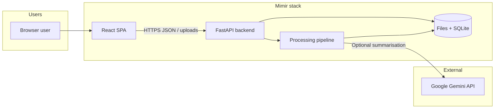
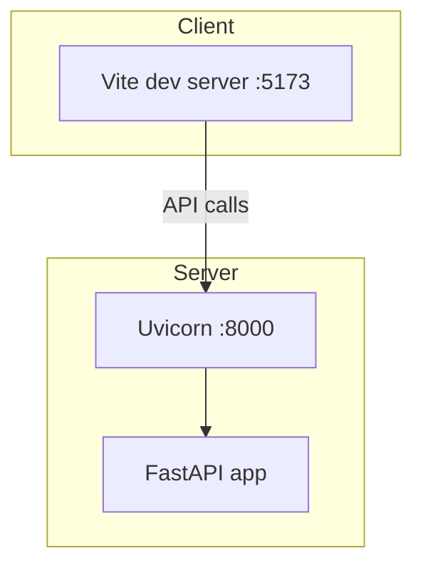
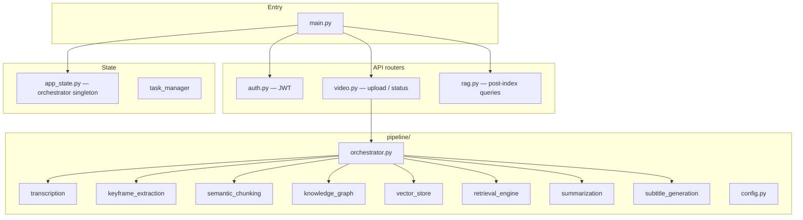
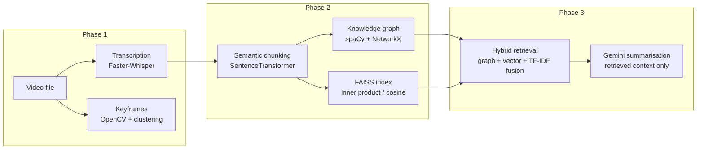
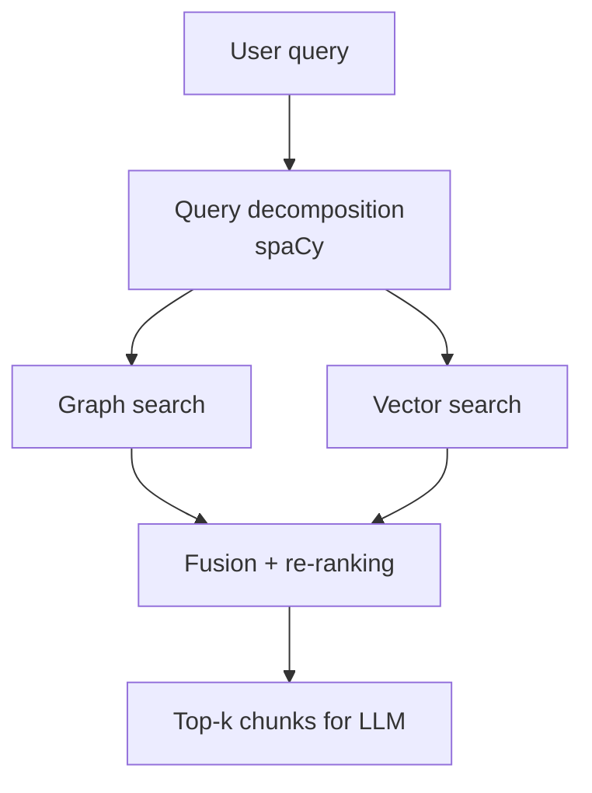
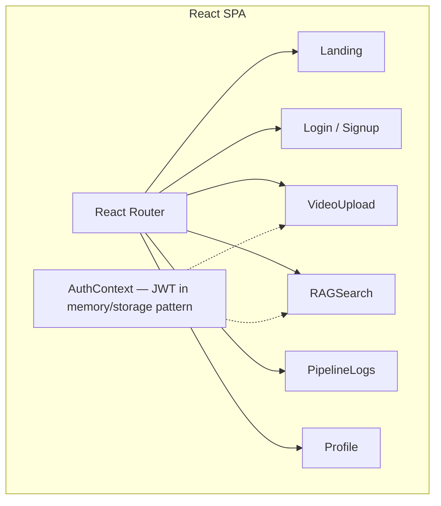
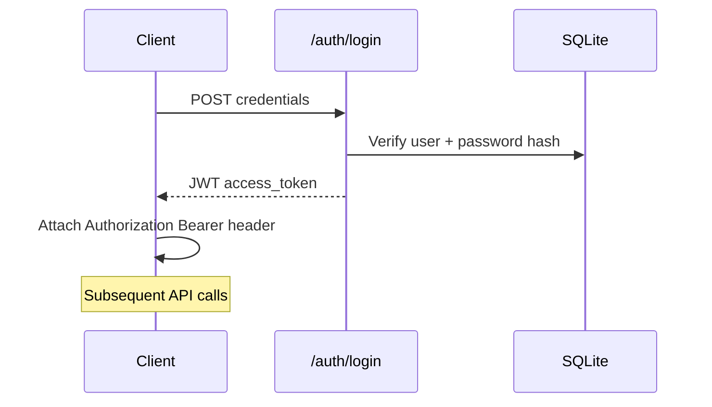
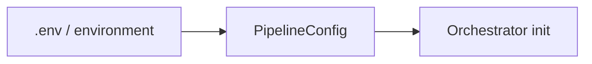
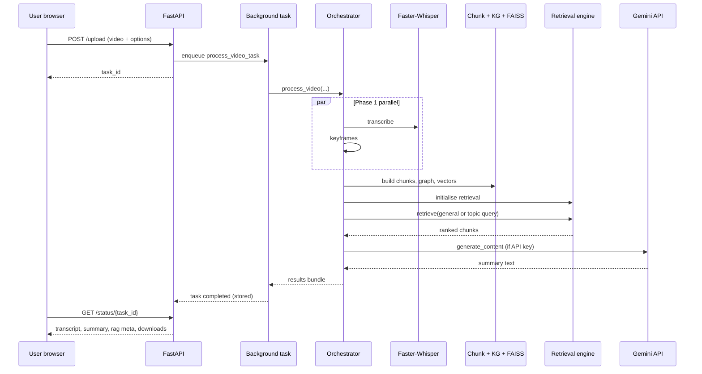

# Mimir — Design & Architecture Document

**Video Intelligence Platform:** transcription, semantic indexing, RAG-based summarisation, keyframe selection, and subtitles.

*Document suitable for academic / college project submission.*

---

## 1. Executive Summary

**Mimir** is a full-stack application that ingests lecture-style or narrative videos, extracts speech as text, builds a **dual-channel retrieval index** (knowledge graph + dense vectors), and generates **grounded summaries** using a cloud LLM only over retrieved transcript chunks. The system also extracts representative **keyframes**, produces **subtitle files**, and exposes **REST APIs** with **JWT authentication** and a **React** web client.

Design goals:

1. **Grounded generation:** summaries are driven by hybrid retrieval, reducing hallucination relative to summarising the entire transcript blindly.
2. **Modular pipeline:** phases are separated (ASR, chunking, indexing, retrieval, generation) behind an orchestrator.
3. **Operational clarity:** asynchronous tasks, progress reporting, and persisted artefacts (indexes, chunks, graphs) per upload.

---

## 2. System Context

The system sits between **end users** (students, instructors, reviewers) and **external AI services** (Google Gemini). Heavy computation runs **on the application server** (Whisper-family ASR, embeddings, FAISS, spaCy); the LLM is invoked **via API** when an API key is configured.

---

## 3. High-Level Architecture

### 3.1 Logical tiers

| Tier | Responsibility | Implementation |
|------|----------------|----------------|
| **Presentation** | Routing, auth gates, upload UX, results & RAG search UI | React 18, React Router, Vite |
| **API & integration** | REST endpoints, CORS, static uploads, background jobs | FastAPI, Uvicorn |
| **Domain / AI pipeline** | Transcription → chunking → KG + vectors → retrieval → summaries / subtitles | Python modules under `backend/pipeline/` |
| **Persistence** | Users, optional task metadata; per-video artefacts | SQLAlchemy + SQLite (`mimir.db`); filesystem under `uploads/` |
| **Task tracking** | In-memory + SQLite-backed task manager for progress/results | `models/task_manager.py` |

### 3.2 Deployment view (typical development)

Production deployments would typically place the SPA behind a CDN or reverse proxy, run Uvicorn/Gunicorn behind nginx, and optionally add Redis/Celery for distributed queues (dependencies exist in requirements; core flow uses FastAPI `BackgroundTasks`).

---

## 4. Backend Application Structure

---

## 5. Processing Pipeline (Core Design)

The orchestrator implements a **multi-phase pipeline**. Phase 1 runs **transcription** and **keyframe extraction** in **parallel** when both are available.

### 5.1 Phase overview

| Phase | Purpose | Main outputs |
|-------|---------|--------------|
| **1** | Audio/visual understanding | Timestamped transcript segments; keyframe set + scene metadata |
| **2** | Dual-channel indexing | Semantic chunks (JSON), knowledge graph (pickle), FAISS index |
| **3** | Hybrid retrieval + summarisation | Ranked chunks → Gemini prompt → summary + key points (topic-aware optional) |
| **4** | Subtitles | SRT/VTT-style timed text |
| **5** | Citations | Links summary evidence to time ranges / keyframes |

### 5.2 Semantic chunking

Chunks are built with a **greedy cosine-drop** strategy:

- Sentences are embedded with **SentenceTransformers** (`all-MiniLM-L6-v2`, 384 dimensions).
- Adjacent sentences are merged into a chunk until cosine similarity drops below a threshold **or** a token budget is exceeded.
- Chunks retain **time boundaries** and **prev/next** pointers for temporal expansion during retrieval.

### 5.3 Knowledge graph channel

- **spaCy** (`en_core_web_sm`) extracts linguistic structure.
- The graph connects entities / phrases and relation-like edges derived from dependency patterns (e.g. subject–verb–object style cues).
- Implemented with **NetworkX**; serialised per video for later RAG API use.

### 5.4 Vector channel

- **FAISS** `IndexFlatIP` with **L2-normalised** vectors → equivalent to **cosine similarity**.
- Embeddings are reused from chunks where possible to avoid duplicate encoder passes.

### 5.5 Hybrid retrieval

The retrieval engine:

1. **Decomposes** the query (entities, keywords, light query typing).
2. Runs **parallel** graph-aware and vector search (**fork–join** async pattern).
3. **Fuses** scores with configurable weights (vector, graph, text overlap via **TF-IDF**).
4. Optionally **expands** neighbouring chunks in time for context.

### 5.6 Summarisation & LLM grounding

- When `GEMINI_API_KEY` (or config) is set, the orchestrator calls **Google Generative AI** with model **`gemini-2.5-flash-lite`**.
- The prompt is constrained to **retrieved** transcript text (truncated window), with separate behaviours for **general** vs **topic-focused** summaries.
- If the API fails or no key is set, the system can fall back to **extractive** summarisation heuristics using the existing **NLTK**-based summariser.

---

## 6. Frontend Architecture

- **Protected routes** redirect unauthenticated users to `/login` while preserving return path.
- Upload sends **multipart** video + JSON **processing options** (transcript, summary, subtitles, topic mode, summary length, etc.).
- Client polls or displays **task status** and renders transcripts, summaries, keyframes, and download links returned by the API.

---

## 7. Security & Authentication

| Aspect | Approach |
|--------|----------|
| **Transport** | HTTPS assumed in production (dev uses plain HTTP locally). |
| **Auth** | JWT access tokens (`HS256`), Bearer scheme via FastAPI dependencies. |
| **Password storage** | **bcrypt** hashing via SQLAlchemy `User` model. |
| **Secrets** | `JWT_SECRET_KEY`, `GEMINI_API_KEY` via environment / `.env` (must not be committed). |
| **CORS** | Configurable allow-list (`cors_origins` in settings). |

---

## 8. Data & Storage Model

### 8.1 Artefacts per upload (conceptual)

Under `uploads/` (keyed by task/video id):

- Original **video** file.
- **Chunks** JSON (semantic segments + embeddings metadata).
- **Knowledge graph** pickle.
- **FAISS** index files + metadata JSON.
- Exported **subtitles**, **keyframes** references for UI.

### 8.2 Databases

- **`mimir.db` (SQLite):** users and schema for optional persisted processing tasks (`ProcessingTask` model exists alongside runtime task manager usage).

---

## 9. Key Technologies

### 9.1 Frontend

| Technology | Role |
|------------|------|
| **React 18** | UI components and state |
| **Vite** | Dev server & production bundling |
| **React Router v7** | Client-side routing |
| **Tailwind CSS v4** | Styling pipeline |
| **Lucide React** | Icons |
| **Recharts** | Charts / analytics-style UI where used |

### 9.2 Backend & runtime

| Technology | Role |
|------------|------|
| **Python 3.12+** (recommended for dependency wheels) | Server language |
| **FastAPI** | REST API framework |
| **Uvicorn** | ASGI server |
| **Pydantic / pydantic-settings** | Settings & validation |
| **SQLAlchemy** | ORM |
| **SQLite** | Embedded DB |
| **PyJWT** | JWT encoding/decoding |

### 9.3 ML / NLP / CV stack

| Technology | Role |
|------------|------|
| **PyTorch** | Device selection; backbone for many libs |
| **Faster-Whisper** | Efficient Whisper-style ASR |
| **FFmpeg** (via **ffmpeg-python**) | Audio extraction from video |
| **OpenCV** (headless) | Frame sampling / video I/O |
| **NumPy / SciPy / scikit-learn** | Signal processing (e.g. median filter), **KMeans** for keyframe clustering |
| **sentence-transformers** | `all-MiniLM-L6-v2` embeddings |
| **FAISS** | Approximate / exact similarity search index |
| **spaCy** + **`en_core_web_sm`** | Tokenisation, NER, linguistic features for KG & query parsing |
| **NetworkX** | Graph data structure & algorithms |
| **NLTK** | Extractive summarisation helper & corpora |

### 9.4 External LLM API

| Service | Model (as implemented) | Use |
|---------|---------------------------|-----|
| **Google AI (Gemini)** | `gemini-2.5-flash-lite` | Abstractive summary + bullet key points from retrieved transcript context |

---

## 10. LLM & Model Inventory (Summary Table)

| Stage | Model / asset | Type | Runs where |
|-------|----------------|------|------------|
| Speech-to-text | Whisper variant via **Faster-Whisper** (size from config, e.g. `tiny`) | Local neural ASR | Backend CPU/GPU |
| Semantic embeddings | `sentence-transformers/all-MiniLM-L6-v2` | Local encoder | Backend |
| Linguistic analysis | `en_core_web_sm` | Local NLP pipeline | Backend |
| Retrieval index | **FAISS** inner-product on normalised vectors | Vector search | Backend |
| Knowledge graph | Rule + dependency-inspired extraction over spaCy docs | Symbolic graph | Backend |
| Summarisation | **Gemini** `gemini-2.5-flash-lite` | Cloud LLM | Google API |
| Fallback summary | NLTK + heuristics | Classical NLP | Backend |

---

## 11. API Surface (Representative)

Prefixes depend on router mounting; primary groups:

- **`/api/v1/auth/*`** — register, login, current user (`/me`).
- **`/api/v1/upload`** — submit video + options; returns `task_id`.
- **`/api/v1/status/{task_id}`** — poll processing state and results.
- **`/api/v1/rag/*`** — query / search after indexing completed for a `video_id`.
- **`/uploads/*`** — static files for processed media artefacts.
- **`/docs`** — OpenAPI (Swagger UI) for exploration.

---

## 12. Configuration & Feature Flags

Central settings (`pipeline/config.py`, env / `.env`) control:

- GPU usage, Whisper model size, upload limits.
- CORS origins, upload directories.
- **`GEMINI_API_KEY`** for cloud summarisation.
- Toggles: transcription, summarisation, subtitles, keyframes, topic analysis, RAG.

---

## 13. Limitations (Honest Assessment for Academic Discussion)

1. **Single-node processing:** background tasks run in-process; very large queues need Redis/Celery horizontal scaling.
2. **SQLite & filesystem coupling:** fine for demos and coursework; production multi-user loads may prefer PostgreSQL + object storage (S3-compatible).
3. **LLM dependence:** quality of abstractive summaries depends on API availability, quotas, and prompt design; fallback is extractive.
4. **Language scope:** pipeline defaults assume **English** (spaCy model, NLTK stopwords); multilingual ASR may still produce non-English text but downstream NLP may degrade.
5. **Security hardening:** JWT secret defaults must be rotated; rate limiting and file validation policies should be tightened for public deployment.

---

## 14. Future Enhancements

### 14.1 Scalability & operations

- **Job queue:** Redis + Celery (or RQ) workers for isolated GPU nodes; task retry & dead-letter queues.
- **Object storage** for videos and indexes; **CDN** for keyframe thumbnails.
- **Horizontal API** scaling behind load balancer with shared storage.

### 14.2 Retrieval & reasoning

- **Cross-video search:** unify multiple FAISS indices or use a shared corpus namespace (already partially reflected in RAG routes).
- **Re-ranking models:** cross-encoder (e.g. small transformer reranker) on top-k candidates.
- **Temporal graph reasoning:** explicit timeline nodes for lecture segments / chapters.

### 14.3 Multimodality

- **Vision-language models** for captioning keyframes and aligning slides with speech.
- **Speaker diarisation** (where legally/ethically appropriate) for multi-speaker debates.

### 14.4 Product & UX

- **Collaborative annotations** on transcript chunks.
- **Export** to LMS formats (SCORM snippets, quiz generation from RAG).
- **Accessibility:** improved keyboard navigation, captions preview player.

### 14.5 Responsible AI

- **Audit logs** of retrieved chunk IDs sent to the LLM for reproducibility.
- **Content safety** filters on uploads and generations.
- Clear **privacy policy** for institutional deployments (FERPA/GDPR-aware retention).

---

## 15. Diagram: End-to-End Sequence (Upload → Summary)

---

## 16. Conclusion

Mimir combines **classical IR** (TF-IDF overlap), **dense retrieval** (sentence embeddings + FAISS), and **structured semantics** (spaCy + knowledge graph) into a **transparent hybrid RAG stack** for educational video. A modern **React** front end and **FastAPI** backend provide an approachable architecture for coursework while leaving clear upgrade paths toward production-scale ingestion, multilingual support, and richer multimodal understanding.

---

## References & Further Reading

1. Radford et al., *Robust Speech Recognition via Large-Scale Weak Supervision* (Whisper) — conceptual basis for Faster-Whisper-style ASR.
2. Reimers & Gurevych, *Sentence-BERT* — dense semantic sentence embeddings.
3. Johnson, Douze & Jégou, *Faiss* — efficient similarity search.
4. Explosion AI, *spaCy* documentation — industrial NLP pipelines.
5. Google AI, *Gemini API* documentation — generative summarisation over API (`https://ai.google.dev/`).

*Internal code references:* `backend/pipeline/orchestrator.py`, `backend/main.py`, `backend/api/*`, `frontend/src/App.jsx`.
